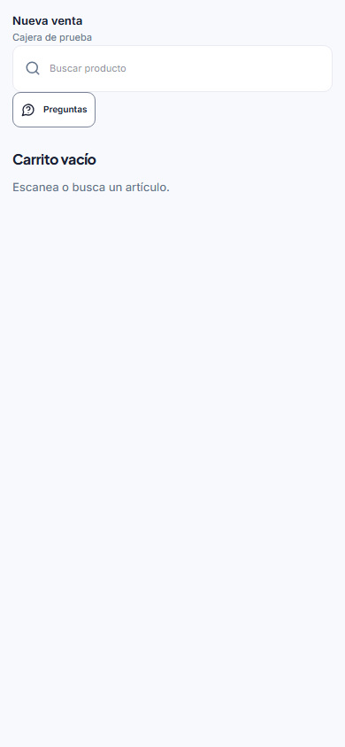
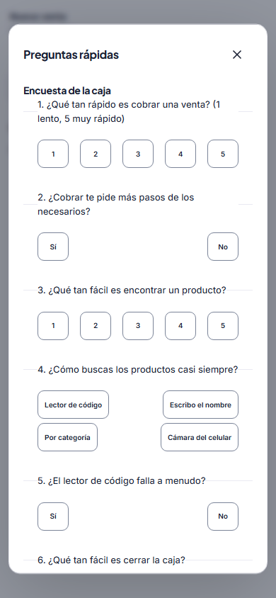

# Manual corto: Preguntas y encuesta de la caja

Este botón sirve para consultar tus ventas y contar cómo te funciona la caja. **No hay respuestas buenas o malas.** Responde lo que realmente te pasa. Nunca escribas contraseñas, PIN, números de tarjeta ni datos de clientes.

## 1. Abrir «Preguntas»

En la pantalla de venta, toca **Preguntas**.

Las preguntas rápidas de venta se responden con datos del sistema. No usan la IA ni gastan preguntas. Si tu caja está abierta, los importes siguen ocultos hasta el cierre; puedes ver cantidades de facturas y unidades.

## 2. Abrir la encuesta

Dentro de **Preguntas rápidas**, baja y toca **Encuesta de la caja (30 preguntas rápidas)**.

- En las preguntas de **1 a 5**, toca `1` si es muy difícil o malo y `5` si es muy fácil o bueno.
- En **Sí / No**, contesta lo que ocurre normalmente.
- Cuando aparezcan opciones, toca solo la que mejor describa tu caso.
- En las dos preguntas para escribir, explica el problema con palabras sencillas y sin datos privados.
- Al final, toca **Guardar respuestas**. Puedes volver después y cambiar una respuesta.

## 3. Cómo contestar las 30 preguntas

|   # | Tema                     | Cómo contestar                                                     |
| --: | ------------------------ | ------------------------------------------------------------------ |
|   1 | Rapidez al cobrar        | Del `1` (lento) al `5` (muy rápido).                               |
|   2 | Pasos para cobrar        | **Sí** si sientes que sobran pasos; si no, **No**.                 |
|   3 | Encontrar productos      | Del `1` (difícil) al `5` (muy fácil).                              |
|   4 | Forma de búsqueda        | Elige lector, nombre, categoría o cámara: la que usas más.         |
|   5 | Fallos del lector        | **Sí** si falla a menudo; si casi nunca falla, **No**.             |
|   6 | Cerrar la caja           | Del `1` (difícil) al `5` (muy fácil).                              |
|   7 | Dudas al contar          | **Sí** si dudas al contar el dinero del cierre.                    |
|   8 | Solicitudes de PIN       | **Sí** si te pide PIN más veces de las necesarias.                 |
|   9 | Permisos                 | **Sí** si una función necesaria para tu trabajo aparece bloqueada. |
|  10 | Mensajes confusos        | **Sí** si algún aviso no se entiende.                              |
|  11 | Equipo principal         | Elige computadora, celular, tableta o varios.                      |
|  12 | Comodidad en celular     | Del `1` (incómodo) al `5` (muy cómodo).                            |
|  13 | Impresión                | **Sí** si el recibo falla, se corta o sale mal.                    |
|  14 | Recibo preferido         | Elige impreso, WhatsApp, correo o no lo piden.                     |
|  15 | Cliente nuevo            | Del `1` (difícil) al `5` (muy fácil).                              |
|  16 | Buscar clientes          | **Sí** si cuesta encontrar a un cliente guardado.                  |
|  17 | Venta a crédito          | Del `1` (difícil) al `5` (muy fácil).                              |
|  18 | Reglas del crédito       | **Sí** si dudas cuándo se puede dar crédito.                       |
|  19 | Devolución               | Del `1` (difícil) al `5` (muy fácil).                              |
|  20 | Pedir una anulación      | **Sí** si sabes cómo pedirla; **No** si necesitas ayuda.           |
|  21 | Descuento u oferta       | **Sí** si sabes aplicarlo correctamente.                           |
|  22 | Transferencia            | **Sí** si sabes registrarla con banco y referencia.                |
|  23 | Lentitud                 | **Sí** si el sistema se pone lento mientras vendes.                |
|  24 | Venta sin internet       | **Sí** si ya te ha tocado vender sin conexión.                     |
|  25 | Información rápida       | Elige lo que más te gustaría consultar sin preguntar.              |
|  26 | Preguntas rápidas        | **Sí** si este botón te ayuda durante el trabajo.                  |
|  27 | Asistente con IA         | **Sí** solo si ya lo has usado.                                    |
|  28 | Satisfacción general     | Del `1` (muy incómoda) al `5` (muy a gusto).                       |
|  29 | Primera mejora           | Escribe el cambio más importante para vender más cómoda.           |
|  30 | Comentario para la dueña | Escribe cualquier otra sugerencia o problema.                      |

Si no entiendes una pregunta, no adivines: pide ayuda antes de guardar.
