# Propuesta de diseño de Nexora POS (paso 1: solo propuesta)

Pedido de la dueña: «quiero que lo actives para usarlo y mejorar el diseño de todo el sistema que tenemos aquí en Nexora».

Este documento **no cambia la aplicación**. Trae 3 direcciones de diseño, maquetas estáticas de 3 pantallas para cada una y un plan para pasar por partes. La dueña escoge una dirección (o una mezcla) y después se programa.

- Maquetas (HTML) y capturas (PNG): `docs/diseno/propuesta/`
- Para regenerarlas: `node docs/diseno/propuesta/generar.mjs`. El programa también comprueba el contraste WCAG de cada color, que los datos de muestra cuadren y que nada desborde a 390 px.
- Los datos son **de muestra** (precios, conteos y facturas inventados con nombres reales de productos y cajeras). No salen de producción.

## 1. Cómo está hoy

| Pieza | Hoy | Problema para la cajera |
|---|---|---|
| Letra | Inter a **13 px**, peso 450 | Pequeña para un mostrador; el ojo se cansa al final del día |
| Color | Morado `#7c3aed` en todo, «Cobrar» en verde | El morado se usa para todo y no distingue nada; el verde de «Cobrar» sí funciona y se queda |
| Caja | Catálogo con fotos de ejemplo, carrito a la derecha, «Cobrar F12» | Tarjetas altas con mucha imagen: caben 6 productos; los precios compiten con el resto |
| Cierre | Formulario largo en una ventana (modal) | Mezcla conteo, tarjeta, entrega y textos de ayuda en un mismo bloque |
| Tablero | Tarjetas iguales con sombra suave | Todo pesa lo mismo: lo urgente (transferencias por verificar) no salta |

Lo que **no cambia** en ninguna dirección: los mismos flujos, los mismos botones con los mismos nombres («Cobrar», «En espera», «Limpiar», «Cerrar caja e imprimir cuadre») y las mismas teclas (**F2** buscar, **F4** cliente, **F8** en espera, **F12** cobrar). El cierre sigue siendo **ciego**: la cajera nunca ve cuánto «debería» haber.

## 2. Reglas comunes a las tres direcciones

1. **El dinero se lee de lejos.** El total a cobrar mide 40–56 px; los precios 17–18 px en negrita, con números de ancho fijo (las columnas de montos quedan alineadas).
2. **Letra base de 15 px** (hoy 13 px). Nada de texto útil por debajo de 12.5 px.
3. **Botones de 44 px como mínimo**; los de acción, 48 px; «Cobrar» 56–64 px y siempre **verde**, abajo a la derecha (en el teléfono, barra fija abajo).
4. **Las teclas se ven en el botón** (`F2`, `F4`, `F8`, `F12`) para que la cajera nueva las aprenda mirando.
5. **Una barra lateral corta** (Vender, Caja, Mercancía, Tablero, Alertas) en vez del menú ancho: más espacio para productos. En el teléfono, el menú de siempre (☰).
6. **Contraste AA o mejor** en claro y oscuro: todo texto ≥ 4.5:1 (ver la tabla del punto 4).
7. **Las existencias bajas se dicen con palabras** («Quedan 2»), no solo con color.
8. **Teléfono a 390 px:** el catálogo pasa a lista de una columna y la venta se resume en una barra fija con el total y «Cobrar».

## 3. Las tres direcciones

### A · Mostrador (recomendada)

La pantalla se porta como la caja registradora: un **visor oscuro** con el total, teclas que parecen teclas y el código de cada producto a la vista.

- **Letra:** Atkinson Hyperlegible Next (hecha para leerse con poca vista y de reojo: la «I», la «l» y el «1» no se confunden). Los montos del visor en Atkinson Hyperlegible Mono.
- **Color (claro):** fondo `#E9ECF2`, superficie `#FFFFFF`, tinta `#161A2E`, gris `#4A5068`, morado Nexora oscurecido `#4C2A9E`, cobrar `#0B6B4F`, visor `#161A2E`.
- **Color (oscuro):** fondo `#0E1018`, superficie `#181B27`, tinta `#ECEEF6`, morado `#BBA6F7`, cobrar `#34C48F`.
- **Forma:** esquinas de 6/10/14 px; las tarjetas de producto tienen el borde inferior más grueso, como una tecla.
- **Lo memorable:** el visor del total (en la caja y en el tablero) y las teclas `F` dibujadas como teclas.

| Caja 1366 | Caja 390 | Caja oscuro |
|---|---|---|
| 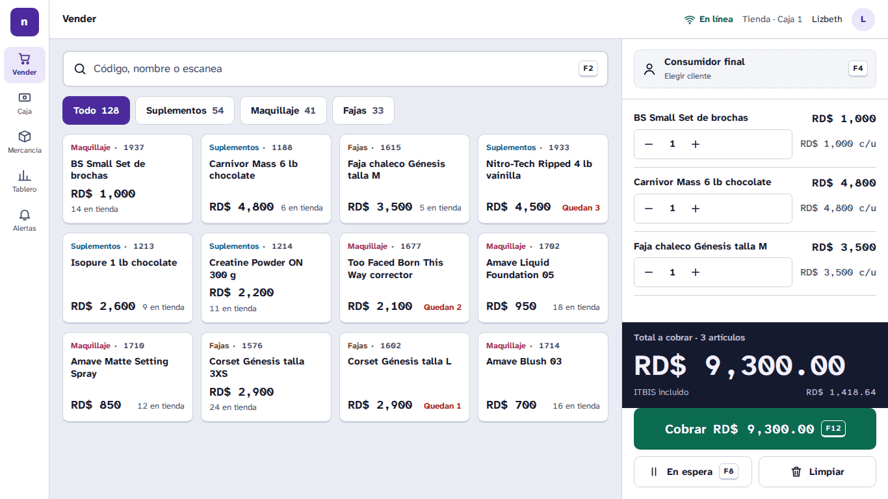 | 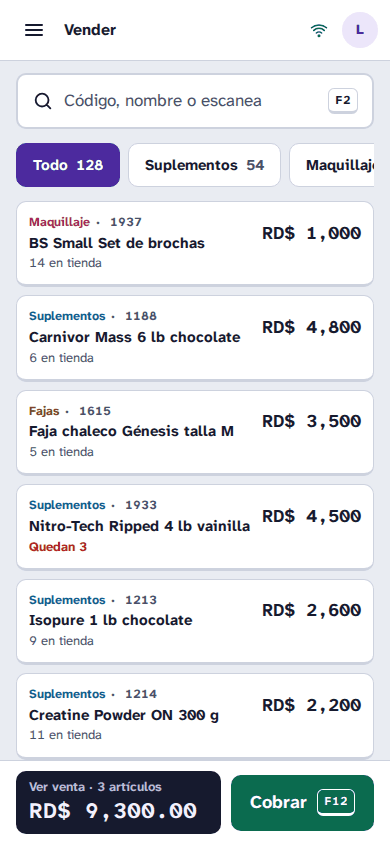 | 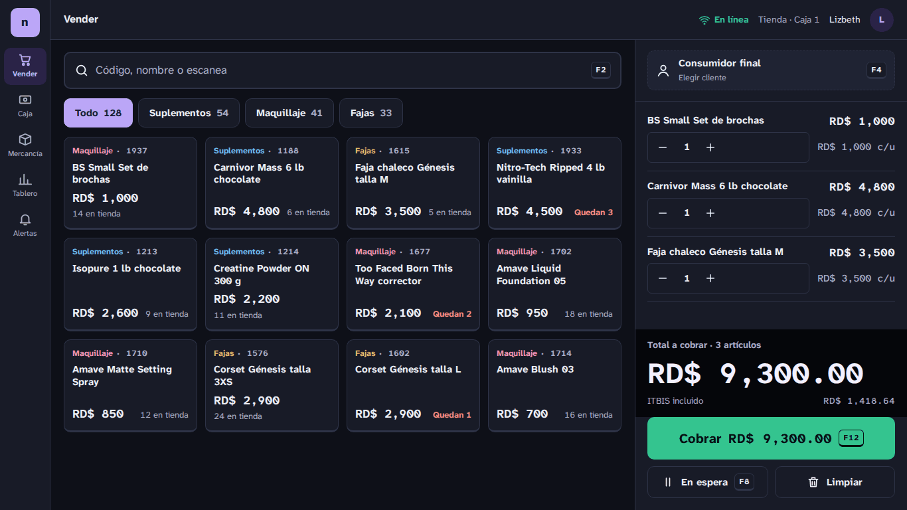 |

| Cerrar caja | Tablero |
|---|---|
| 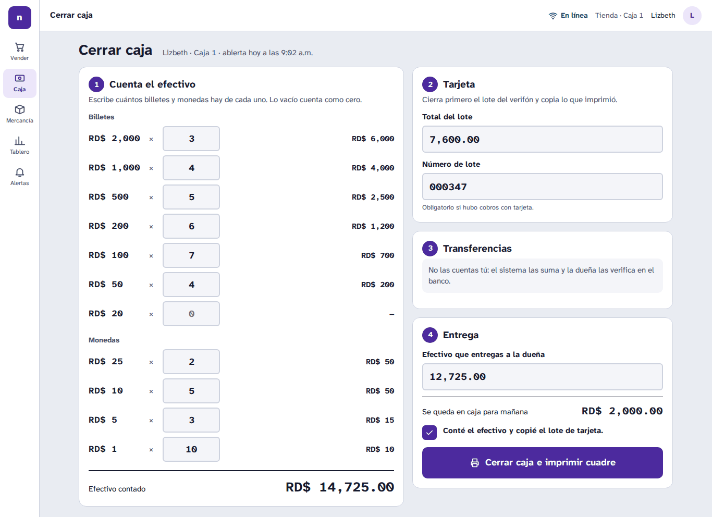 | 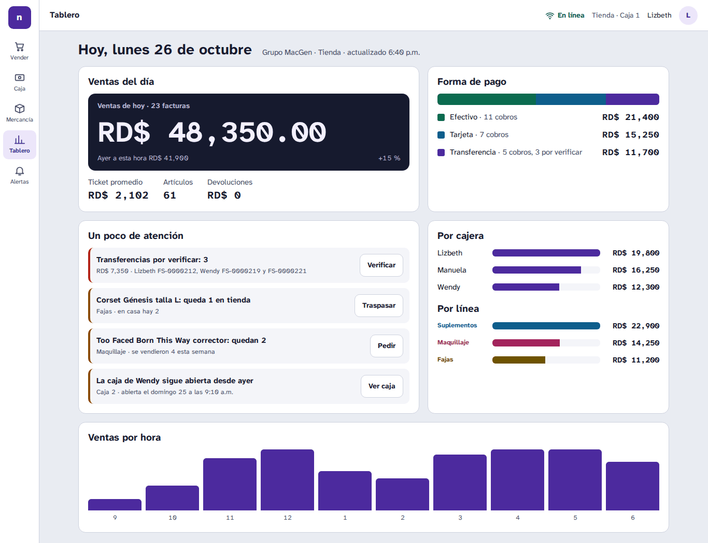 |

### B · Tocador

Un mostrador de belleza: tonos rubor y ciruela y un **pigmento por línea** (verde oliva suplementos, frambuesa maquillaje, cacao fajas). Encaja con GV Makeup Studio.

- **Letra:** Figtree para todo; Young Serif solo en títulos y en el total.
- **Color (claro):** fondo `#FBF4F4`, superficie `#FFFFFF`, tinta ciruela `#2B1630`, gris `#6B5260`, frambuesa `#8E2A57`, cobrar `#1D6B48`.
- **Color (oscuro):** berenjena `#1A1119`, superficie `#241823`, tinta `#F6E9EF`, rosa `#F0A6C6`, cobrar `#4CC48A`.
- **Forma:** botones y buscador en píldora, tarjetas de 16 px sin borde, carrito flotante.
- **Lo memorable:** las muestras de color (como una paleta de sombras) en cada producto y filtro.

| Caja 1366 | Caja 390 | Caja oscuro |
|---|---|---|
| 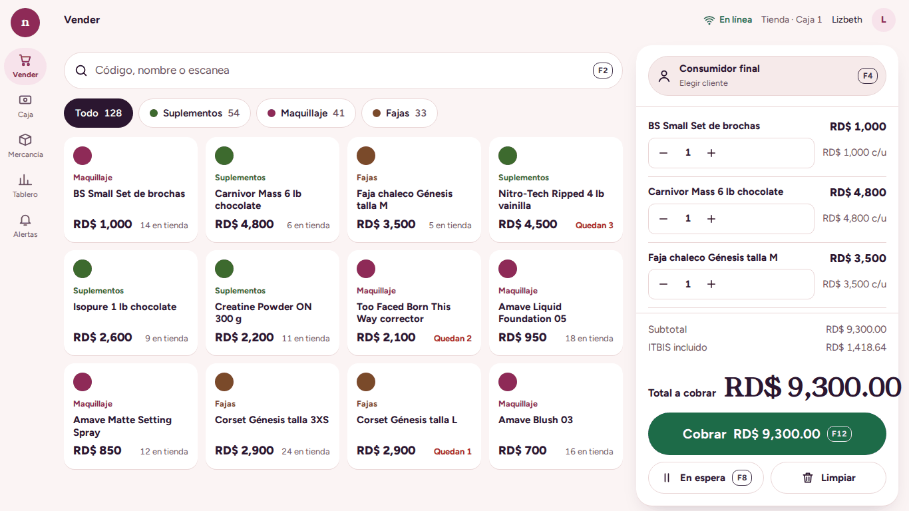 | 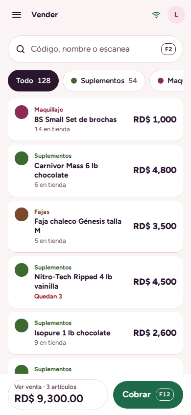 | 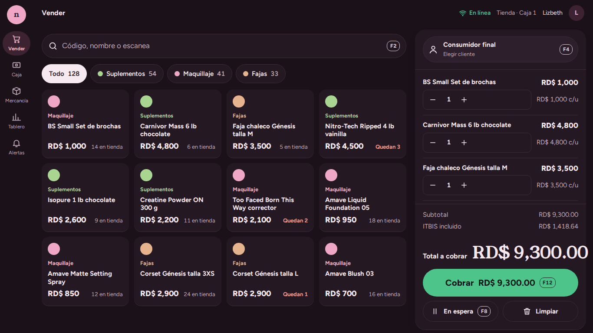 |

| Cerrar caja | Tablero |
|---|---|
| 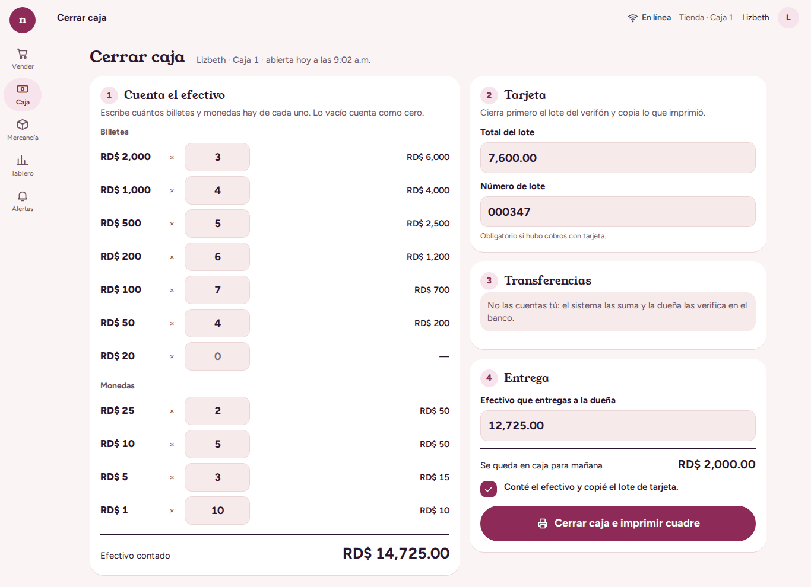 | 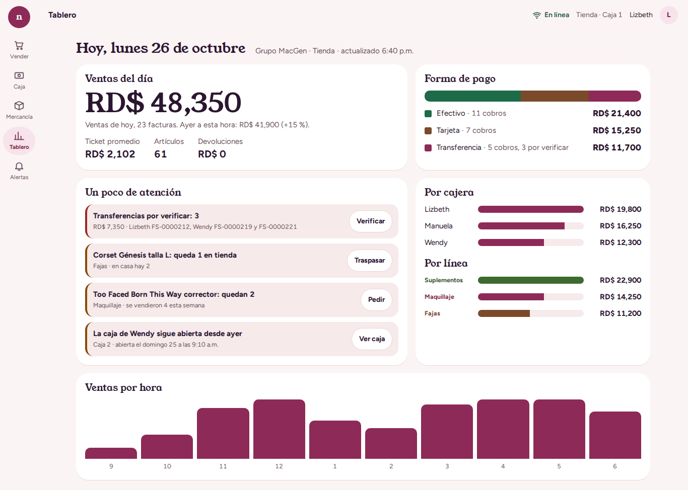 |

### C · Tres líneas

El color dice **de qué línea es cada cosa**: un filo de color a la izquierda de cada producto y de cada renglón de la venta (azul suplementos, frambuesa maquillaje, ocre fajas). Barra superior oscura y números condensados para que quepan más montos.

- **Letra:** Barlow; Barlow Semi Condensed para montos y títulos.
- **Color (claro):** fondo `#EEF2F1`, superficie `#FFFFFF`, tinta `#0F2A2E`, gris `#46605F`, cobrar `#157347`, líneas `#0B5F86` / `#A8325E` / `#7A5A00`.
- **Color (oscuro):** fondo `#0C1719`, superficie `#132225`, tinta `#E6F0EE`, cobrar `#3CCB7F`.
- **Forma:** esquinas de 4/6/8 px, densa, más productos por pantalla.
- **Lo memorable:** el filo de color por línea, que también ordena el tablero (ventas por línea).

| Caja 1366 | Caja 390 | Caja oscuro |
|---|---|---|
| 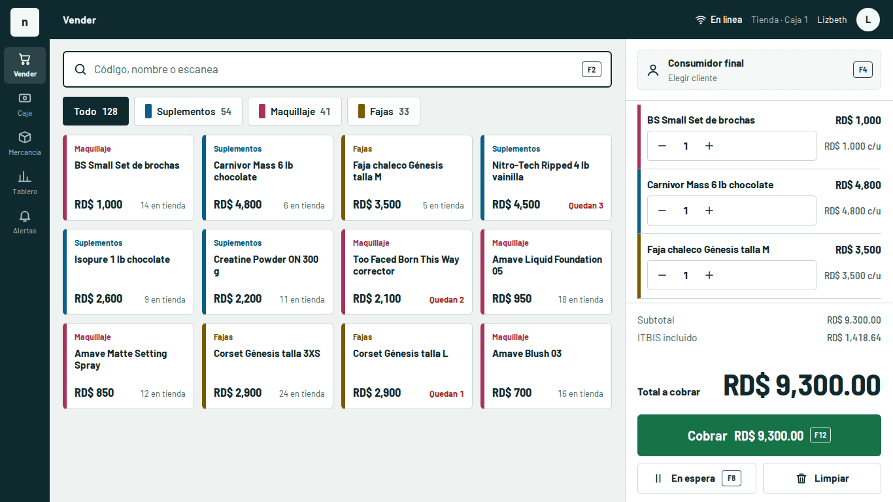 | 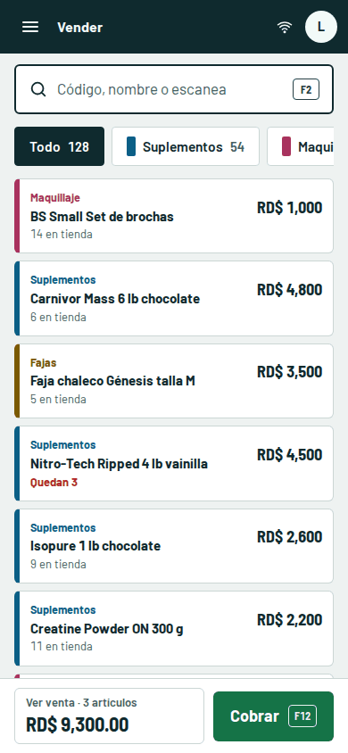 | 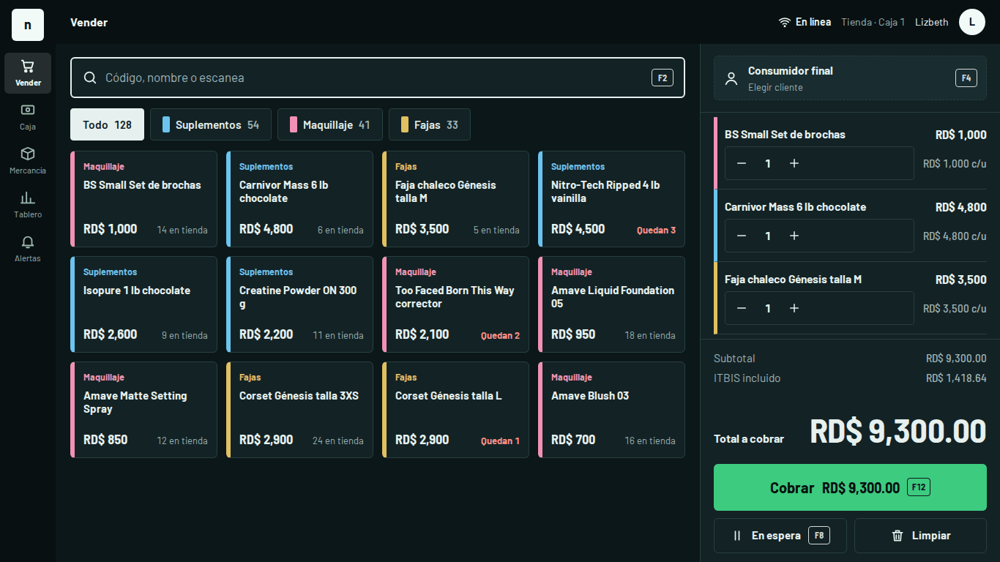 |

| Cerrar caja | Tablero |
|---|---|
| 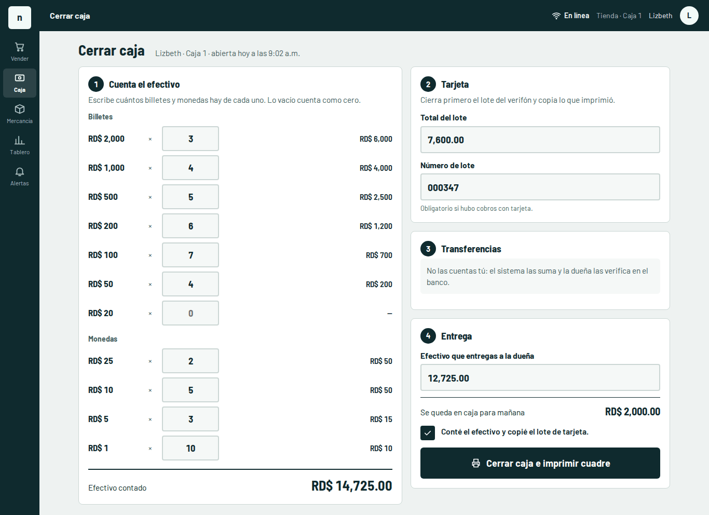 | 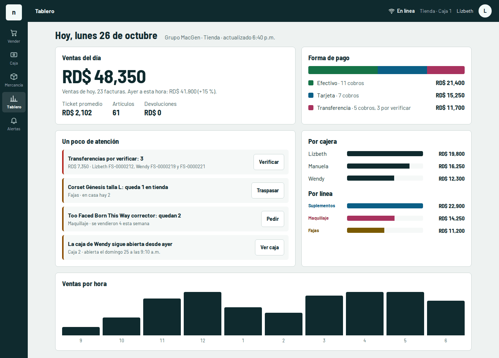 |

Las capturas de cierre y tablero a 390 px están en la misma carpeta (`*-cierre-390.png`, `*-tablero-390.png`).

## 4. Contraste comprobado (WCAG)

Calculado por `generar.mjs` con cada par de texto y fondo usado (tinta, gris, morado, peligro, aviso, líneas, texto sobre «Cobrar» y sobre el visor). Si un par baja de 4.5:1, el programa se detiene.

| Dirección | Tema | Peor par | Contraste del peor par | Tinta sobre superficie |
|---|---|---|---|---|
| Mostrador | claro | línea suplementos / superficie gris | 6.43 | 17.2 |
| Mostrador | oscuro | línea maquillaje / superficie gris | 6.89 | 14.8 |
| Tocador | claro | línea suplementos / superficie rubor | 5.42 | 16.7 |
| Tocador | oscuro | gris / superficie | 7.23 | 14.5 |
| Tres líneas | claro | texto sobre «Cobrar» | 5.87 | 15.1 |
| Tres líneas | oscuro | línea maquillaje / superficie gris | 6.57 | 14.1 |

## 5. Recomendación: A · Mostrador

1. **Es la que menos cambia la costumbre.** Sigue el mismo orden de pantalla de hoy (catálogo a la izquierda, venta a la derecha, «Cobrar» verde abajo) y conserva el morado de Nexora, solo más oscuro y con mejor contraste. La cajera reconoce la pantalla el primer día.
2. **Es la más legible en el mostrador.** Atkinson Hyperlegible está diseñada para leerse rápido y sin confundir caracteres, lo que importa con códigos (1213, 1214) y montos. El visor oscuro hace que el total sea lo primero que se ve, también para la clienta.
3. **Sirve para las tres líneas y para el producto Nexora.** No depende del rubro de belleza (B) ni de que el negocio tenga exactamente tres líneas (C), así que se puede vender a otras tiendas.
4. **Se queda lo mejor de las otras dos:** el color por línea de C como etiqueta de texto (ya está en A) y, para el **módulo GV**, la frambuesa de B como color de acento de esa empresa.

## 6. Plan para pasar por partes

Cada parte es un PR aparte, con los 3 CI en verde (`verify`, `windows-installer`, `render-images`), capturas antes y después a 1366 y 390 px en claro y oscuro, y visto por la dueña antes de desplegar.

1. **Fichas de diseño (tokens).** Cambiar los valores de las variables de `apps/web/src/styles.css` (`--bg`, `--surface`, `--text`, `--muted`, `--primary`, `--focus`, etc.) y agregar las nuevas (`--cobrar`, `--display`, `--sup`, `--maq`, `--faj`, radios y escala de letra). **Se conservan los nombres** que ya existen para que todo lo de hoy siga funcionando. Agregar la fuente con `@fontsource` (como ya se hace con Inter) para que funcione **sin internet**. Subir la letra base de 13 a 15 px. Sin tocar componentes todavía.
2. **Caja / Vender (`POS.tsx`).** Visor del total, teclas visibles, tarjetas de producto más bajas con código y existencia, barra fija con «Cobrar» en el teléfono. Mismos textos y roles de los botones.
3. **Cerrar caja (`Tienda.tsx`).** Pasos numerados (efectivo, tarjeta, transferencias, entrega), billetes y monedas separados, campos de 48 px. Sigue ciego: la cajera no ve el monto esperado.
4. **Tablero (`Dashboard.tsx`).** Ventas del día en el visor, forma de pago, por cajera, por línea y «Un poco de atención» con botón de acción en cada alerta.
5. **Módulo GV Makeup Studio** (`docs/coordinacion/MODULO-GV.md`). Nace ya con las fichas nuevas y la frambuesa como acento de GV; no se construye con el diseño viejo.
6. **Resto de pantallas** (Mercancía, Compras, Reportes, Gestión) heredan las fichas del paso 1; se pulen después, de una en una.

## 7. Riesgos y cómo se evitan

| Riesgo | Cómo se evita |
|---|---|
| **Romper la costumbre de las cajeras** | Mismos nombres de botones, mismas teclas, mismo lugar de «Cobrar» y mismo verde. Avisar a Lizbeth, Manuela y Wendy un día antes, con una captura. Cambio de una pantalla a la vez, nunca todas juntas. |
| **Romper las pruebas de punta a punta (e2e)** | Las pruebas buscan por rol y nombre: «Cobrar», «Limpiar», «Finalizar venta», «Agregar pago», «Abrir caja», «Guardar», «Caja abierta», «Venta registrada». Esos textos **no cambian**. Las clases que usan (`.product-card`, `.cart-items`, `.connection`, `.main-content .loading`, `.main-content h1`) se conservan aunque cambie su estilo. |
| **Contraste que baje sin que nadie lo note** | `tests/accessibility-contract.test.ts` ya lee las variables de `styles.css` y exige 4.5:1 en `--text`, `--muted`, `--primary`, `--focus` y `--primary-soft`. Se amplía con `--cobrar`, `--display`, `--sup`, `--maq` y `--faj`. |
| **La letra no carga sin internet** | Fuente empaquetada con `@fontsource`, igual que Inter hoy; el service worker la guarda. |
| **Letra más grande que desborde** | `tests/e2e/caja-cierre-movil.spec.ts` y las pruebas de 390 px; se agrega una comprobación de que no haya desplazamiento horizontal a 320 y 390 px. |
| **Impresos** | El ticket y el cuadre de 80 mm (`Prints.tsx`) no cambian en esta etapa. |
| **Accesibilidad** | `tests/e2e/accesibilidad.spec.ts` (roles, nombres, foco y, con `NEXORA_AXE_SCRIPT`, axe-core) debe seguir en 0 errores graves. |

## 8. Qué tiene que decidir la dueña

1. ¿Cuál dirección: A (recomendada), B, C o una mezcla?
2. ¿El tema oscuro se ofrece a las cajeras o solo a la dueña?
3. ¿Se empieza por la caja (lo que más se usa) o por el tablero (lo que ve la dueña)?
