# Guía rápida de Clary · GV Makeup Studio

Para usar desde el celular. Los nombres en **negrita** son los botones y pestañas tal como aparecen en Nexora.

> Las imágenes de esta guía se tomaron el 26 de octubre de 2026 en una base local de prueba. «Alba Ejemplo», «Bianca Demostración», «Carla Prueba», «Diana Muestra» y «Elena Interesada» son datos ficticios; no pertenecen a clientas reales.

## 1. Entrar al sistema

1. Abre Nexora en el navegador del celular.
2. En **Usuario** escribe el usuario que te entregó la dueña.
3. En **Contraseña** escribe tu contraseña y toca **Entrar a mi tienda**.
4. Si aparece «Actualiza tu contraseña», crea una contraseña nueva, repítela y toca **Guardar contraseña y entrar**. No la compartas.

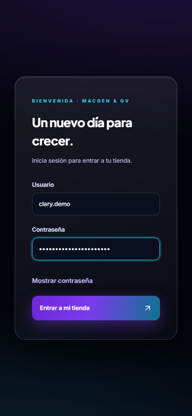

## 2. Abrir GV Makeup Studio

1. Toca el botón de tres líneas de la esquina superior izquierda.
2. Toca **GV Makeup Studio**.
3. Tu menú de Clary muestra GV Makeup Studio y no muestra Caja, costos, Configuración ni los reportes de Macgen.

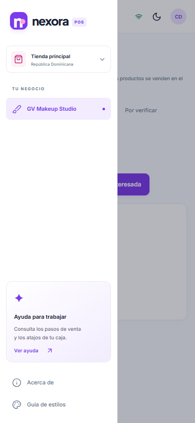

Al entrar verás cinco pestañas: **Cursos**, **Citas**, **Interesadas**, **Por verificar** y **Reportes**.

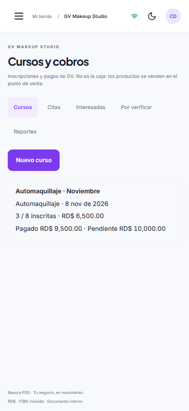

## 3. Crear o editar un curso

1. En **Cursos**, toca **Nuevo curso**.
2. Llena **Nombre**, **Tipo**, **Fecha**, **Precio (RD$)** y **Cupo**.
3. Toca **Guardar**. Debe aparecer «Curso creado.»
4. Para cambiarlo después, abre el curso y toca **Editar curso**.

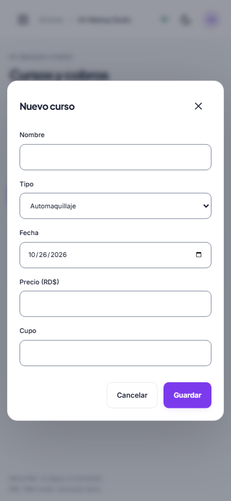

## 4. Inscribir a una clienta

1. En **Cursos**, toca el curso correcto.
2. Toca **Nueva inscripción**.
3. Escribe **Clienta**, **Teléfono** e **Instagram**.
4. Revisa **Precio acordado (RD$)**. Sale con el precio del curso; cámbialo solamente si se acordó otro precio.
5. Deja **Estado** en «Activa» y **Asistió** en «Sin marcar» si el curso todavía no se realizó.
6. Toca **Guardar**. Debe aparecer «Inscripción guardada.»

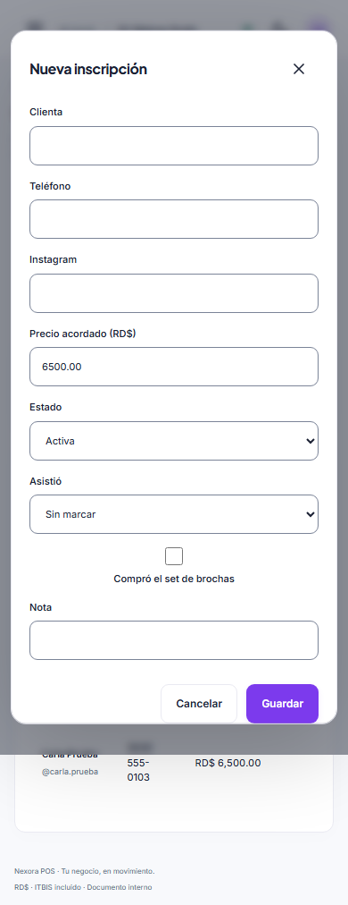

Después de guardar, la clienta aparece dentro del curso con lo pagado y lo pendiente.

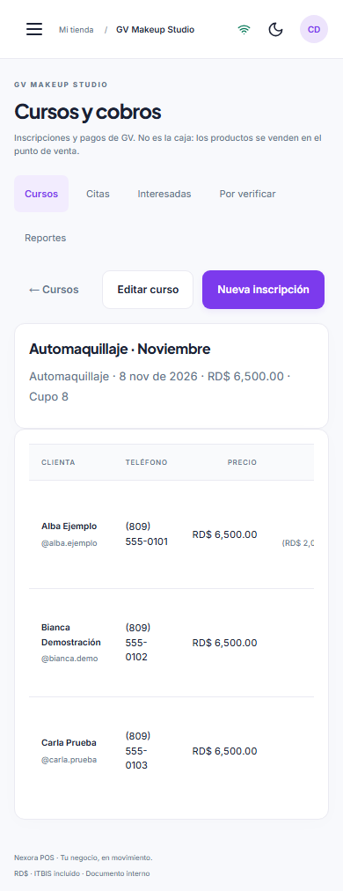

## 5. Registrar un pago

1. Dentro del curso, busca la clienta y toca **Pago**.
2. Revisa la **Fecha** y escribe el **Monto (RD$)** recibido.
3. En **Concepto** elige:
   - **Separo**: primer pago para guardar el lugar.
   - **Restante**: lo que falta para completar.
   - **Segundo pago** o **Tercer pago**: cuando paga en partes.
4. En **Método** elige **Efectivo**, **Transferencia** o **Tarjeta**.
5. Para transferencia, llena siempre **Banco** y **Referencia** con los datos del comprobante.
6. Toca **Registrar pago**. Debe aparecer «Pago registrado.»

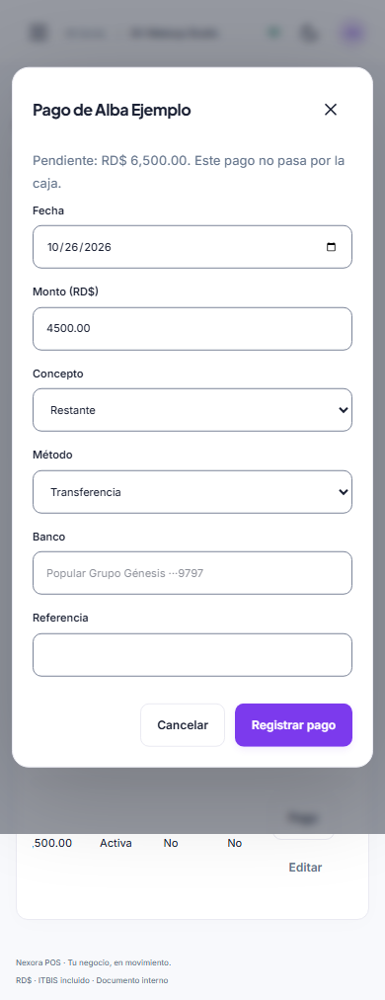

El efectivo y la tarjeta quedan verificados. Una transferencia queda **Por verificar** hasta que gerencia confirme que el dinero llegó. Los pagos de GV no pasan por la caja normal.

## 6. Transferencias por verificar

1. Abre **Por verificar**.
2. Comprueba que estén correctos el nombre, el curso o cita, la fecha, el monto, el banco y la referencia.
3. Avísale a Génesis o a la dueña para que revise el banco.
4. Clary puede ver el pendiente, pero **no puede verificarlo ni rechazarlo**. Solo gerencia o administración tiene esos botones.
5. Nunca marques un pago como recibido basándote únicamente en una foto del comprobante.

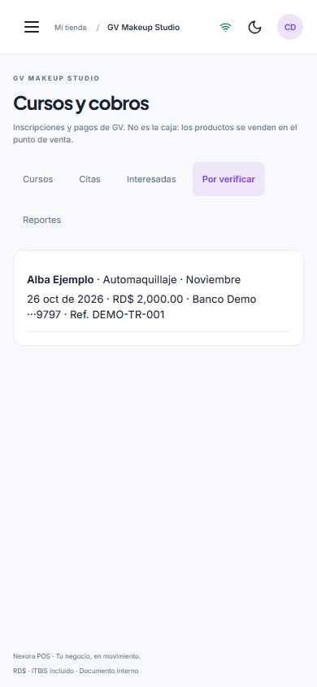

## 7. Ver lo pagado y lo pendiente

1. En **Cursos**, cada tarjeta muestra **Pagado** y **Pendiente**.
2. Dentro del curso, revisa el pendiente de cada clienta. Si aparece «por verificar», todavía falta confirmar la transferencia.
3. En **Reportes**, usa **Desde** y **Hasta** para elegir fechas.
4. Revisa **Ingresos**, **Por día**, **Por método**, **Por banco**, **Por empleada**, **Ocupación y pendientes por curso** y **Pendientes por clienta**.

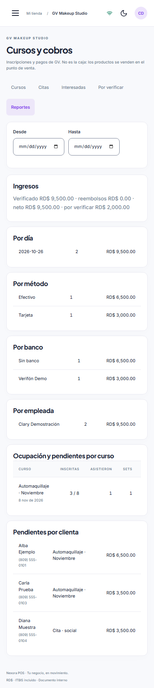

## 8. Marcar asistencia y set de brochas

1. Dentro del curso, busca la clienta y toca **Editar**.
2. En **Asistió**, elige **Sí**, **No** o **Sin marcar**.
3. Marca **Compró el set de brochas** solamente cuando corresponda.
4. Si cambió o canceló, ajusta **Estado**: Activa, No asistió, Cambió a personalizado, Cancelada o Reembolsada.
5. Escribe una **Nota** si hace falta y toca **Guardar**.

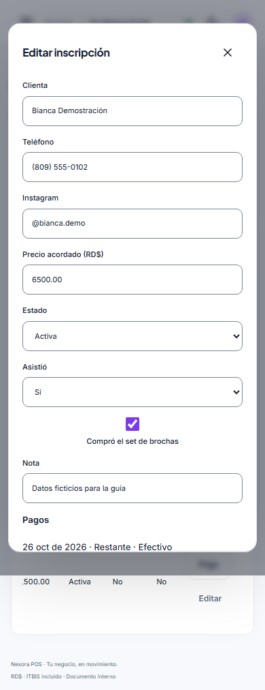

La marca del set solo sirve para el seguimiento de GV. El cobro y la entrega del set se registran como venta en la caja normal de Macgen.

## 9. Crear y cobrar una cita

1. Abre **Citas** y toca **Nueva cita**.
2. Llena clienta, teléfono, Instagram, fecha y hora, servicio y artistas.
3. Marca **Fuera de horario** solo cuando corresponda.
4. Escribe el total y, si aplica, la propina. Para bodas también puedes anotar cotización, personas y lugar.
5. Toca **Guardar**.

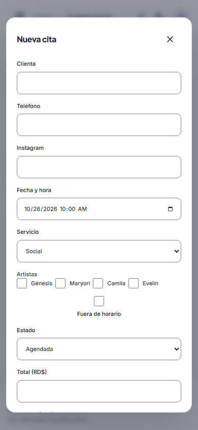

La cita aparecerá en la lista. Para cobrarla, toca **Pago** y sigue las mismas reglas de efectivo, tarjeta o transferencia del punto 5.

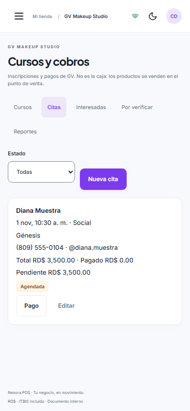

## 10. Registrar una interesada

1. Abre **Interesadas** y toca **Nueva interesada**.
2. Escribe **Nombre**, **Teléfono**, **Interés**, **Acción a tomar** y una nota si hace falta.
3. Deja el estado correcto: Por contactar, Contactada, Inscrita o Descartada.
4. Toca **Guardar**.

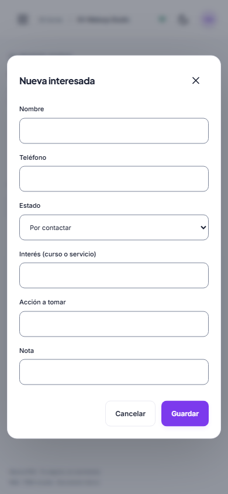

Después puedes usar **Editar** para cambiar el estado o la próxima acción.

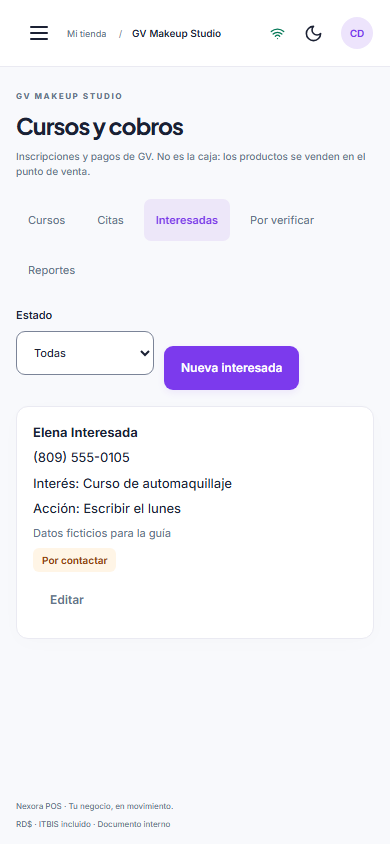

## 11. Lo que no se hace en GV

- No vendas productos, sets de brochas, Amave ni otros artículos desde GV: se venden en la caja normal de Macgen.
- No uses GV como factura ni como cuadre de caja. Es un registro de cursos, citas, clientas y pagos de GV.
- No compartas tu contraseña.
- No inventes banco o referencia. Si falta un dato de la transferencia, pídeselo a la clienta.
- No verifiques una transferencia: avisa a Génesis o a la dueña.

Si algo no sale, toma una captura de la pantalla y envíasela a la dueña o a Génesis junto con una explicación corta de lo que estabas haciendo.
